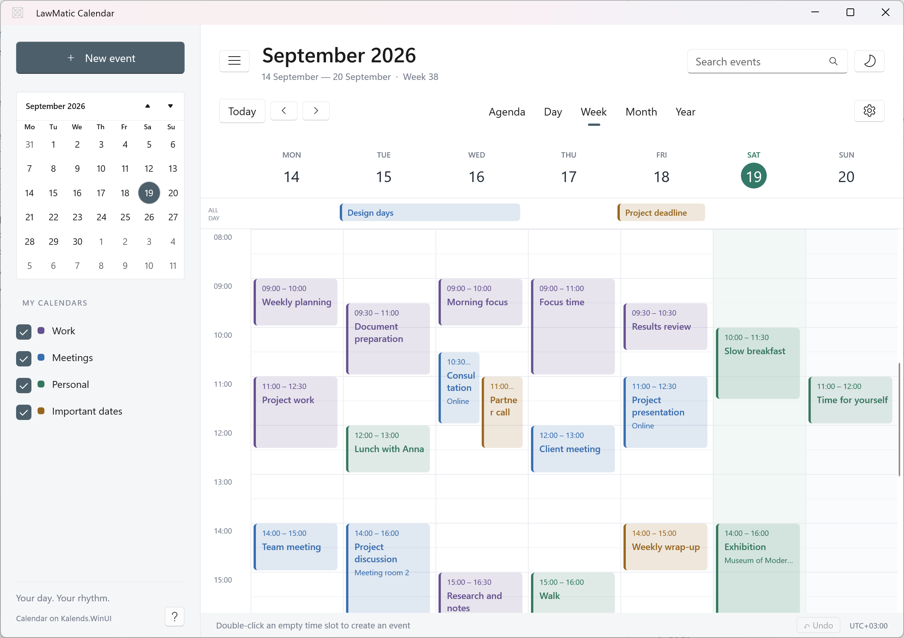

# Kalends.WinUI

WinUI 3 calendar views with event layout and drag-and-drop. The host owns storage, sync, and editing.

<!-- GitHub About: WinUI 3 calendar views with event layout and drag-and-drop. Topics: winui3, calendar, csharp. License is MIT in LICENSE — do not add a second license file when creating the repo if you will push this tree. -->

[](https://learn.microsoft.com/windows/apps/winui/winui3/)
[](#installation)
[](LICENSE)
[](.github/workflows/ci.yml)



## Features

- Agenda, day, week, month, and year
- Overlap lanes for timed events and spanning all-day rows
- Drag empty time up/down to select a time range, with 15-minute snap; double-click empty time for a one-hour draft
- Drag events to move them or drag an edge to resize them
- Select events with one click; double-click or press Enter to request editing, and press Esc to clear the selection
- Press Delete on a selected event or use its context menu to request deletion
- Culture-aware week start, locale-formatted dates, light / dark / high contrast
- Host-owned events through `IKalendsEvent` — no providers, sync, or storage types

## Requirements

- Windows 10 1809 or later
- .NET 10
- Windows App SDK 2.5

## Installation

```powershell
dotnet add package Kalends.WinUI
```

Until 1.0.0, consume the library as a project reference or a local `dotnet pack` output.

```xml
<ProjectReference Include="..\kalends-winui\src\Kalends.WinUI\Kalends.WinUI.csproj" />
```

## Quick Start

```xml
xmlns:kalends="using:Kalends"

<kalends:KalendsView x:Name="Calendar" />
```

```csharp
Calendar.Events = events;
Calendar.Date = DateTime.Today;
Calendar.EditRequested += (_, e) => OpenEditor(e.Event);
Calendar.SelectionChanged += (_, e) => ShowSelection(e.Event);
Calendar.TimeChanged += (_, e) => SaveMove(e.Event, e.Start, e.End);
Calendar.DeleteRequested += (_, e) => DeleteEvent(e.Event);
```

Call `Calendar.Refresh()` after changing the host-owned event collection so the view displays the changes immediately.

`Calendar.SelectedEventId` is a bindable dependency property. The host can set it to an event ID or `null`, read `Calendar.SelectedEvent` to get the corresponding item, and listen to `SelectionChanged`. Selection is retained across view refreshes and cleared when the selected event leaves the host's event collection.

The library supplies the event context menu and raises `DeleteRequested` for the Delete key or menu command. The host decides whether to confirm and remove the event, then calls `Refresh()`. Read-only events do not offer deletion.

Your event type implements `IKalendsEvent` (`Id`, `Title`, `Start`, `End`, `IsAllDay`, `Color`, `IsReadOnly`). `End` is exclusive.

## Customization

- Replace `KalendsStrings` for another language
- Set `Culture` and `FirstDayOfWeek`
- Set `KalendsMetrics.TimeFormat` if you need 12-hour labels (`"t"`); the default is `HH:mm`
- Provide `CreateEvent` so new tiles use your model
- Override `Kalends*Brush` keys in the application resources

The default path stays two assignments and the event handlers you care about.

### Day header

`ShowDayHeader` controls the weekday and date row in Day mode. It defaults to `false` because the host app may already show the full date above the calendar. Week mode always shows its day headers.

Set it in XAML or change it at runtime; the view refreshes automatically:

```xml
<kalends:KalendsView x:Name="Calendar" ShowDayHeader="True" />
```

```csharp
Calendar.ShowDayHeader = settings.ShowDayHeader;
```

The host app can expose this value in its own settings if end users need to choose.

### Day classification

Set `DayInfoProvider` to a synchronous lookup in host-owned data:

```csharp
var days = new Dictionary<DateOnly, KalendsDayInfo>
{
    [new DateOnly(2026, 12, 31)] = new()
    {
        Kind = KalendsDayKind.TransferredDayOff,
        Description = "Day off transferred from another date",
    },
};
Calendar.DayInfoProvider = date => days.TryGetValue(date, out var info) ? info : null;
Calendar.HighlightWeekends = true;
Calendar.HighlightHolidays = true;
Calendar.ShowWorkingDayMarkers = true;
```

Return the resolved kind for each `DateOnly`, including ordinary working days and
weekends. Return `null` to fall back to Saturday/Sunday. Lookups are cached for each
refresh; call `Refresh()` after changing the underlying data. This hook performs
no storage or network work. `IsShortened` can accompany a working transfer.

Day/week, month, year and agenda use the same classification. Tooltips and
automation help text include the description; markers complement color in contrast
themes. Year view uses `*` for shortened days. Override `KalendsWeekendTextBrush`,
`KalendsDayOffBrush`, `KalendsDayOffTextBrush` and `KalendsWorkingDayTextBrush` for
host styling, and the corresponding `KalendsStrings` labels and markers for localization.
The highlight switches only affect presentation. `ShowWeekends` retains its existing
meaning: hiding the Saturday/Sunday columns in week/month and dates in agenda.

## Sample

Open `Kalends.slnx` and run `samples/Kalends.WinUI.Sample`.

```powershell
dotnet build src/Kalends.WinUI/Kalends.WinUI.csproj
dotnet build samples/Kalends.WinUI.Sample/Kalends.WinUI.Sample.csproj -p:Platform=x64
dotnet test tests/Kalends.WinUI.Tests/Kalends.WinUI.Tests.csproj
dotnet pack src/Kalends.WinUI/Kalends.WinUI.csproj -c Release
```

## License

MIT. Copyright (c) 2026 LawLabs (ООО «Лаборатория юридических исследований»).
